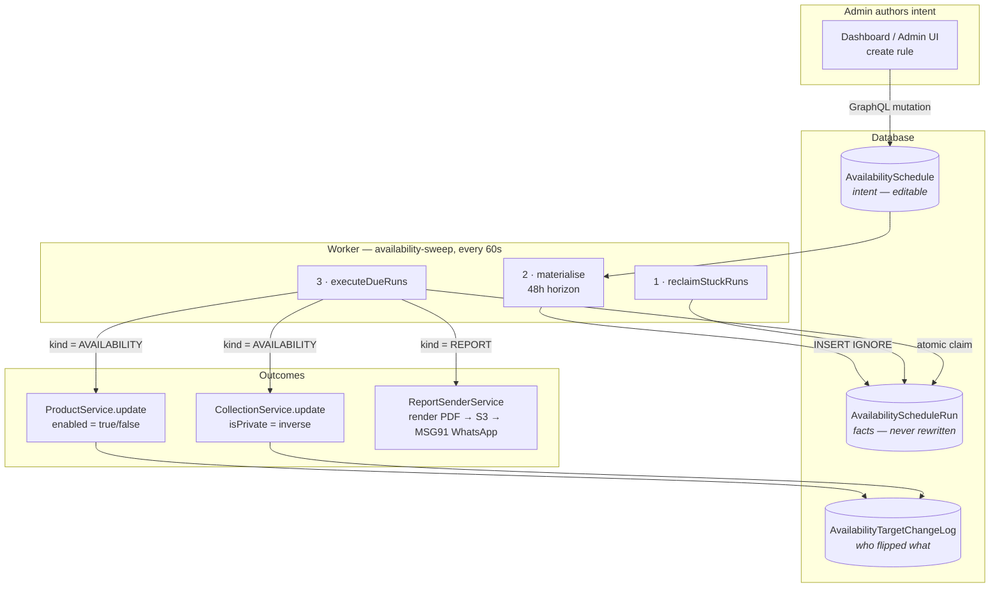
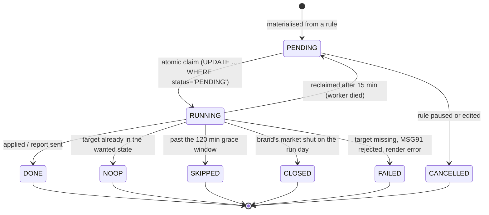
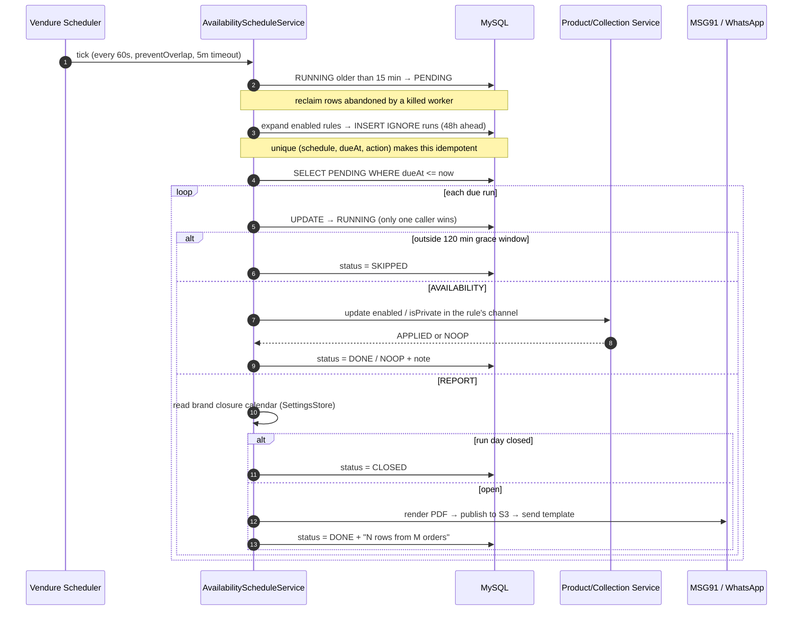
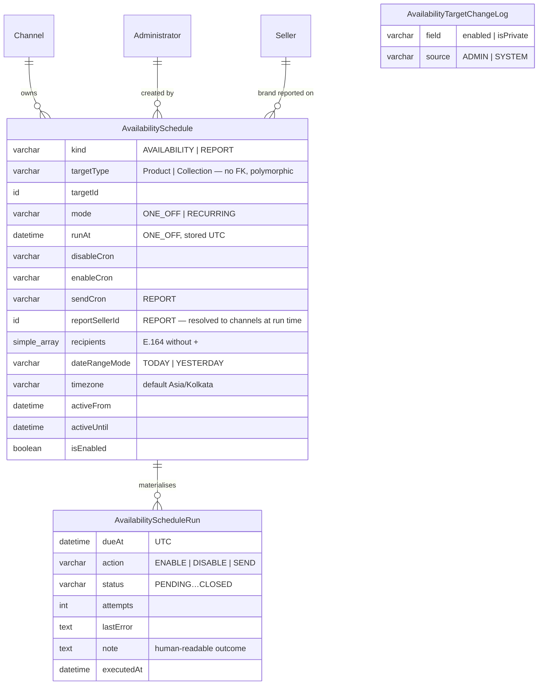

# Scheduled Work — Availability & Report Automation

> Plugin: `src/plugins/Essentials/scheduled-availability`
> Status: **shipped** (availability + purchase-list reports + brand market closures)
> Branch: `rolelogs` / `latest` · Vendure `^3.6.3`
> Last substantive commit: `31335ff` (2026-08-13)

---

## 1. The problem

Two jobs were being done by a human, at a fixed hour, every single day.

**A. Turning products and collections on and off by hand.**

The catalogue is not always sellable. Some items only sell on certain days; some
collections must vanish for a festival; a city channel closes its ordering window
every night. Before this plugin, that meant someone opening the Admin UI at 22:00
and toggling `enabled` / `isPrivate`, then remembering to toggle it back at 06:00.

What went wrong with that:

| Failure | Consequence |
| --- | --- |
| Human forgets the evening toggle | Storefront takes orders it cannot fulfil |
| Human forgets the morning toggle | Storefront stays dark, sales lost silently |
| Six city channels | The same toggle six times, or the wrong channel toggled |
| No record of who flipped what | "Why is this product hidden?" is unanswerable |

**B. Producing and sending the purchase list.**

Every day the purchasing team needs one sheet: what to buy, aggregated from the
day's orders, per city. It was generated by hand and forwarded on WhatsApp. Same
class of failure — missed days, wrong date window, wrong city, no audit.

And a third problem hiding inside B: **the market is shut every Friday**, plus
festivals. A report sent on a closed day is noise. Worse, the orders placed on
that closed day were never bought against — they simply fell off the next day's
list.

---

## 2. What the automation does

One worker-side task ticks every minute. It turns *rules an admin wrote* into
*concrete run rows*, then applies them and records the outcome.



**Two kinds of rule share one table and one engine:**

| | `AVAILABILITY` | `REPORT` |
| --- | --- | --- |
| What it does | Enables / disables a Product or Collection | Renders the purchase list, sends it on WhatsApp |
| Cron fields | `disableCron` + `enableCron` (a pair) | `sendCron` (single) |
| Actions produced | `DISABLE`, `ENABLE` | `SEND` |
| Scope | One target, one channel | A whole brand (`Seller`) — all its city channels |
| Modes | `ONE_OFF` or `RECURRING` | `RECURRING` only |

Reusing one engine means the report inherits the grace window, the stuck-run
reclaim, the run history and the idempotent materialisation for free.

---

## 3. Life of one run



`CLOSED` is deliberately **not** folded into `SKIPPED`. `SKIPPED` means the
worker missed its window — an operational fault worth investigating. `CLOSED` is
routine and happens weekly. Merging them buries real faults in a crowd of normal
ones.

---

## 4. One sweep tick, in order



Order matters and is not accidental — see [`tasks/availability-sweep.task.ts`](tasks/availability-sweep.task.ts):

1. **Reclaim first** — a row abandoned by a killed worker becomes eligible in the
   *same* tick that would otherwise ignore it.
2. **Materialise before executing** — a rule created seconds ago whose first
   occurrence is already due fires now, not a minute later.

---

## 5. Market closures — the walk-back window

Closure calendar lives in the Vendure **SettingsStore**, scoped by brand
(`Seller`), not by channel. One Kaaikani entry covers Madurai, Salem,
Coimbatore, Trichy and Kochi.

```json
{ "closedWeekdays": [5], "closedDates": ["2026-08-15", "2026-10-20"] }
```

The rule applied to every REPORT run:

1. Run day closed → send nothing, record `CLOSED`.
2. Otherwise `k` = consecutive closed days immediately before the run day.
3. Window = `from = target − k` … `to = target`, full days in the rule's timezone.
4. `k` capped at **7 days** — a longer stretch means a misconfigured calendar, and
   silently pulling a month of orders into one sheet is worse than under-reporting.

Friday closed, daily rule, covering today's orders:

```
   MON      TUE      WED      THU      FRI      SAT      SUN
    │        │        │        │        ▓        │        │
    ▼        ▼        ▼        ▼      CLOSED     ▼        ▼
  [Mon]    [Tue]    [Wed]    [Thu]   no send   [Fri──Sat] [Sun]
   k=0      k=0      k=0      k=0    recorded     k=1      k=0
                                     as CLOSED     ▲
                                                   └── Friday's orders
                                                       absorbed here
```

Festival on Saturday next to the weekly Friday closure:

```
  FRI ▓ closed        SAT ▓ closed        SUN ▶ run, k=2
                                          covers [Fri ─────────── Sun]
```

Design detail and rejected alternatives: [`DESIGN-market-closures.md`](DESIGN-market-closures.md).

---

## 6. Data model



Key modelling calls:

- **Rule = intent, Run = fact.** Runs are never rewritten to a new time. Editing a
  rule deletes only its `PENDING` rows and re-materialises; `DONE` / `FAILED` rows
  are the audit trail and are untouched.
- **Unique `(schedule, dueAt, action)`** is what makes materialisation idempotent
  at the engine level. A read-then-write existence check leaves a race in the gap.
- **`targetId` is polymorphic** — no foreign key, so a deleted product leaves the
  rule behind and surfaces as a `FAILED` run with a readable reason rather than
  vanishing.
- **`reportSellerId`, not a frozen channel list.** A city added to the brand later
  is picked up by existing rules without re-editing them. (`reportChannelIds` is
  the superseded column, kept because dropping columns is irreversible.)

---

## 7. Admin surfaces

Both frontends are live in this project, so the plugin ships twice.

| Surface | Path | Capability |
| --- | --- | --- |
| React Dashboard | [`dashboard/`](dashboard/) | Full CRUD — list, detail, create, cron builder, run history, target picker |
| Angular Admin UI | [`ui/`](ui/) | Read-only list — see [`ui/routes.ts`](ui/routes.ts) |

Dashboard screens:

- **List** — every rule in the active channel, with `latestRun` and `nextRun`
  attached so "did this actually fire?" is answerable without one request per row.
  `allChannels: true` gives a read-only cross-channel overview.
- **Create / Detail** — [`schedule-form-fields.tsx`](dashboard/schedule-form-fields.tsx)
  switches its whole shape on `kind`.
- **Cron builder** — [`cron-builder.tsx`](dashboard/cron-builder.tsx). Cron is easy
  to get wrong and expensive to get wrong on a live storefront.
- **Preview** — `previewAvailabilitySchedule` computes the next 10 occurrences of an
  *unsaved* rule and persists nothing, turning a silent mistake into a visible list.
- **Run history** — [`run-history-table.tsx`](dashboard/run-history-table.tsx), with
  the `note` column carrying the real figures (`"142 row(s) from 38 order(s), 4 page(s)"`).

### Screenshots

<!-- Drop PNGs in ./docs/img/ and they render here and in GitHub Projects. -->

| | |
| --- | --- |
|  |  |
| *Rule list with next/last run* | *Availability rule + cron builder* |
|  |  |
| *Report rule — brand, recipients, covering* | *Run history with statuses and notes* |
|  |  |
| *Settings Store — brand closure calendar* | *Delivered purchase list PDF* |

---

## 8. The reliability decisions

This is the part worth reviewing — the scheduling itself is the easy half.

| Risk | Mechanism | Where |
| --- | --- | --- |
| Sweep runs twice / after a crash → duplicate runs | Unique index + `INSERT IGNORE` (`.orIgnore().updateEntity(false)`) | [`availability-schedule.service.ts:306`](services/availability-schedule.service.ts#L306) |
| Two processes execute the same run | Conditional `UPDATE … WHERE status='PENDING'`, only one gets `affected = 1` | [`:551`](services/availability-schedule.service.ts#L551) |
| Worker down overnight → 22:00 disable fires at 03:00 | `STALE_RUN_GRACE_MINUTES = 120`, older runs marked `SKIPPED` | [`decide-run-disposition.ts`](functions/decide-run-disposition.ts) |
| Worker killed mid-run → row stuck `RUNNING` forever | `STUCK_RUN_RECLAIM_MINUTES = 15`, reclaimed to `PENDING` + warn log | [`:408`](services/availability-schedule.service.ts#L408) |
| Backlog killed mid-tick | Task `timeout: '5m'` (default 60s equals the interval), `preventOverlap: true` | [`availability-sweep.task.ts`](tasks/availability-sweep.task.ts) |
| Repository write skips the search index | Always through `ProductService` / `CollectionService`, never the repository | [`target-applier.registry.ts:103`](services/target-applier.registry.ts#L103) |
| Target picked in the wrong channel | `availabilityTargetSearch` takes an explicit `channelId`; missing targets report the channel by name, not `error.entity-with-id-not-found` | [`target-applier.registry.ts:150`](services/target-applier.registry.ts#L150) |
| WhatsApp shows a stale PDF | Object key carries time-of-day — Meta caches media **by URL**; observed on runs 13440/13471/15611 (2026-08-07) | [`report-storage.service.ts`](services/report-storage.service.ts) |
| Report silently widened to every city | `channelIds` never falls back to "all channels"; a brand with no channels → `SKIPPED` | [`:490`](services/availability-schedule.service.ts#L490) |
| MSG91 returns HTTP 200 with a body-level error | Body `type` checked, not just the status code | [`report-sender.service.ts`](services/report-sender.service.ts) |
| Local PDF dir grows forever | `report-prune` task, `REPORT_LOCAL_RETENTION_DAYS = 7`, top level only, `.pdf` only, no symlinks, no recursion | [`tasks/report-prune.task.ts`](tasks/report-prune.task.ts) |
| Collection has no `enabled` column | Polarity inversion (`isPrivate`) centralised in one registry | [`target-applier.registry.ts`](services/target-applier.registry.ts) |

---

## 9. Configuration

| Variable | Default | Meaning |
| --- | --- | --- |
| `AVAILABILITY_SWEEP_EVERY_MIN` | `1` | Sweep interval in minutes |
| `REPORT_LOCAL_RETENTION_DAYS` | `7` | Local debug-PDF retention; `0` or negative **disables** pruning |
| `REPORT_PRUNE_HOUR` | `3` | Prune hour, server timezone (age is absolute) |
| `REPORT_OUTPUT_DIR` | `static/reports` | Local PDF copies |
| `REPORT_S3_BUCKET` / `REPORT_S3_REGION` / `REPORT_S3_PREFIX` | `cdn.kaaikani.co.in` / `ap-south-1` / `reports` | Report object storage |
| `REPORT_PUBLIC_BASE_URL` | derived | Set when a CDN fronts the bucket |
| `MSG91_AUTH_KEY`, `MSG91_HELLO_NUMBER`, `MSG91_TEMPLATE_NAMESPACE` | — | Required; a missing one names itself in the run-history detail |
| `MSG91_REPORT_TEMPLATE` | `scheduling` | Approved WhatsApp template carrying a document header |

Constants that are code, not env: `MATERIALISATION_HORIZON_HOURS = 48`,
`STALE_RUN_GRACE_MINUTES = 120`, `STUCK_RUN_RECLAIM_MINUTES = 15`,
`MAX_CLOSURE_WALK_BACK_DAYS = 7`, `DEFAULT_SCHEDULE_TIMEZONE = Asia/Kolkata`.

⚠️ The worker does **not** hot-reload. Restart it after any change here.

---

## 10. Admin API

```graphql
availabilitySchedules(options, allChannels)   # channel-scoped; allChannels widens read only
availabilitySchedule(id)
availabilityScheduleRuns(scheduleId, options)
availabilityTargetSearch(targetType, channelId, term)
previewAvailabilitySchedule(input, count)     # persists nothing

createAvailabilitySchedule(input)
updateAvailabilitySchedule(input)
deleteAvailabilitySchedule(id)
setAvailabilityScheduleEnabled(id, isEnabled) # pause; CANCELs pending runs, keeps history
cancelAvailabilityScheduleRun(runId)
runAvailabilityScheduleNow(id)                # materialise + drain one rule immediately
```

`allChannels: true` widens what can be **seen**, never what can be **done** — every
mutation and the single-rule query stay scoped to the request context.

---

## 11. Test coverage

| Suite | Proves |
| --- | --- |
| [`compute-occurrences.spec.ts`](functions/compute-occurrences.spec.ts) | Cron → UTC instants across the India/UTC date boundary, active bounds, disable-only rules, late-created one-offs |
| [`decide-run-disposition.spec.ts`](functions/decide-run-disposition.spec.ts) | Grace-window boundaries both directions, including not-yet-due |
| [`market-closure.spec.ts`](functions/market-closure.spec.ts) | Closed weekdays, ad-hoc dates, walk-back counting and its cap |
| [`availability-schedule.service.spec.ts`](services/__tests__/availability-schedule.service.spec.ts) | Claim/apply/DONE, NOOP notes, FAILED + attempt count, lost-claim path, and every input-validation rejection |
| [`resolve-report-window.spec.ts`](services/__tests__/resolve-report-window.spec.ts) | Closure-aware date windows |
| [`resolve-seller-channels.spec.ts`](services/__tests__/resolve-seller-channels.spec.ts) | Brand → channels, default channel excluded |
| [`prune-local-copies.spec.ts`](services/__tests__/prune-local-copies.spec.ts) | Retention boundary, non-PDFs, symlinks, subdirs, missing dir, retention `0` |
| [`scheduled-availability.e2e-spec.ts`](e2e/scheduled-availability.e2e-spec.ts) | Full stack: preview, one-off disable/enable, NOOP, channel scoping |

Run with `bunx vitest --config vitest.unit.config.mts` (backend config — the root
`vitest.config.mts` is dashboard-only).

---

## 12. Known gaps / next up

| # | Item | Note |
| --- | --- | --- |
| 1 | Closure calendar has no dedicated UI | Edited through the core Settings Store page; a CRUD screen would have to be built twice (React + Angular) |
| 2 | No alerting on `FAILED` runs | Visible in run history only; nobody is told |
| 3 | Non-`PURCHASE_LIST` report types fall back to the placeholder PDF | `ScheduledReportType` has one member; adding a second is migration-free |
| 4 | Single-worker assumption for the grace window | Claim is atomic, but a multi-worker deploy has not been load-tested |
| 5 | `reportChannelIds` column is dead | Superseded by `reportSellerId`; kept because dropping a column is irreversible |

---

## 13. Suggested GitHub Projects breakdown

Cards to create, in the order they are worth doing:

| Card | Type | Size |
| --- | --- | --- |
| Alert on `FAILED` scheduled runs (WhatsApp/email to ops) | Feature | M |
| Closure-calendar editor screen (React Dashboard) | Feature | M |
| Load-test the atomic claim with 2+ workers | Chore | S |
| Second report type (proof the seam holds) | Feature | M |
| Retire the dead `reportChannelIds` column | Chore | S |
| Capture and commit the six README screenshots | Docs | S |
